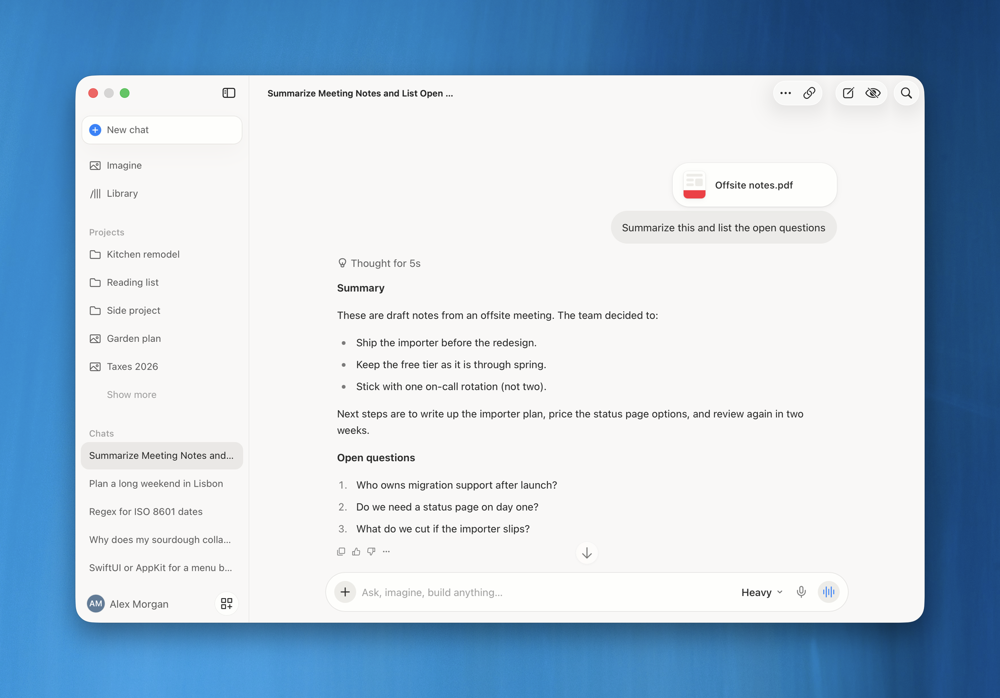
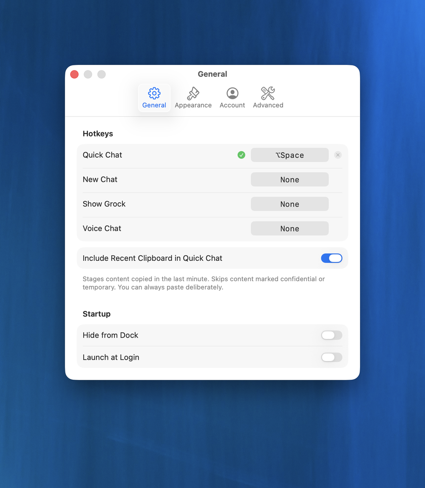
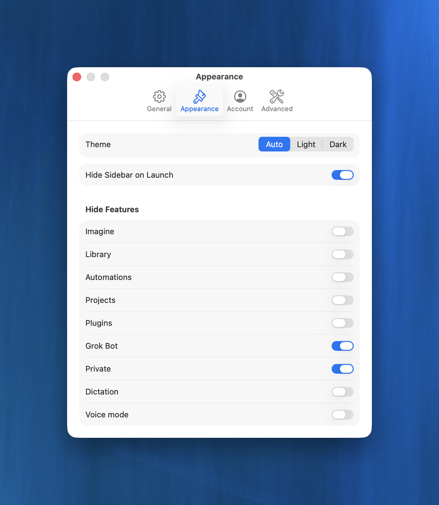

<div align="center">


# Grock

**Grok, at home on your Mac.**

[](https://github.com/jaredatch/grock/actions/workflows/ci.yml)
[](https://github.com/jaredatch/grock/releases/latest)

[](LICENSE)



</div>

Grock is a native Mac app for [grok.com](https://grok.com). It puts all of Grok (chat, Imagine, voice, projects) in a proper Mac window, signed in with the account you already have. Then it adds what a browser tab can't do: Quick Chat on a global hotkey, files handed over from Finder and the Dock, a Dock badge when an answer lands, and a `grock` command for scripts.

There's no API key, no Electron, and no rebuilt chat UI. The conversation is grok.com; Grock is the Mac around it.

Unofficial. Not affiliated with xAI or SpaceX.

## Install

Download the latest `Grock-x.y.z-arm64.zip` from [Releases](https://github.com/jaredatch/grock/releases/latest), unzip it, and drag Grock to Applications. It's signed and notarized, so Gatekeeper won't complain. From then on it checks for updates by itself and asks before installing one.

Or install it with Homebrew, which links the `grock` command for you:

```
brew install --cask jaredatch/tap/grock
```

You need macOS 26 or later on Apple silicon, plus a grok.com account (free or SuperGrok). The first launch opens grok.com's own sign-in page inside the app. If sign-in ever gets stuck, Settings → Account → Clear Web Data… wipes Grock's cookies so you can start over.

## What it does

**The whole of grok.com, in its own window.** The page inside is grok.com itself, so everything works the way it does in your browser. Grock gives it a native titlebar with the sidebar toggle, the chat title, New Chat, Private, and Search, plus More and Share once you're in a conversation. Citations and other outside links open in your browser. Esc or the close button hides the window and hands focus back to whatever you were doing.

**Quick Chat.** ⌥Space opens a small card from anywhere. Type, paste, or drop in files, then press Return. Grock starts a fresh conversation on grok.com, attaches everything, sends it once, and brings up the window with the answer on its way. Anything you copied in the last minute is already on the card, unless your password manager marked it confidential. Esc, or clicking anywhere else, throws the card away.

<p align="center"></p>

**Hand Grok a file from anywhere.** Drop it on the Dock icon or the menu bar icon, use Open With, or run `open -a Grock notes.pdf`, and it lands on a Quick Chat card. Finder's Services → Ask Grok opens a New Chat in the window instead. Either way the file is attached and nothing goes anywhere until you press Return.

**A badge when the answer lands.** Ask something heavy and go back to work. If you aren't looking when Grok finishes, the Dock icon gets a `1` and the menu bar icon changes. Click the Dock icon or use Show Grock, and you're scrolled straight to the answer.

**Hotkeys you choose.** Quick Chat is ⌥Space out of the box. New Chat, Show Grock, and Voice Chat stay unset until you pick a shortcut. Show Grock brings the window to the Space you're on and the display under your cursor, and it never hides a window that's already up. None of this needs Accessibility access.

**Dock, menu bar, or both.** Run Grock from the Dock like any other app, or turn on Hide from Dock and it lives in the menu bar. Launch at Login starts it quietly in the background.

**Downloads that work.** Generated images and files land in `~/Downloads`. A footer tells you when a download finished or failed, with a Show in Finder button.

**Hide what you don't use.** Appearance settings have a switch for each part of grok.com, like Projects, Plugins, or voice mode. The theme follows your Mac unless you pin it to light or dark.

<p align="center">


</p>

## Automate it

Anything on your Mac can open Grock with a URL. Nothing in these links sends on its own, so you always get the last word.

```
grock://                                   show the window
grock://new                                empty New Chat, prompt focused
grock://new?text=Summarize%20this          New Chat with that text staged
grock://ask?text=Summarize%20this          Quick Chat with that text staged
grock://imagine?generate=a%20red%20bicycle Imagine with the prompt filled in
```

`new` and `ask` also take `file=/absolute/path`, as many times as you like. A path on its own doesn't give Grock permission to read the file, though. If macOS says no, Grock keeps your prompt and shows a Choose File… button so you can pick it yourself, or Continue Without Them to drop the files it couldn't read.

There's a `grock` command too, and Homebrew links it for you. If you installed from the ZIP, Settings → Advanced → Install CLI… shows a command to paste into Terminal. Grock is sandboxed and can't write to `/opt/homebrew/bin` or `/usr/local/bin` by itself, so you run that one line and it may ask for your password.

```
grock                          # show the window
grock ask "summarize this"     # Quick Chat
grock new -f notes.pdf         # New Chat, file attached
pbpaste | grock ask            # stdin is the prompt
grock imagine a red bicycle
```

Files passed with `-f` work from anywhere your shell can read. The CLI hands Grock temporary access to each one, so you won't see a file picker or need Full Disk Access. Whichever way they arrive, Quick Chat takes up to 20 files, 12 MB each and 24 MB in total.

Raycast, Alfred, and Shortcuts can call the CLI for files or use the URL scheme for text. Native apps can hand over file access with bookmarks; [File handoff](docs/ARCHITECTURE.md#file-handoff) has the details.

## Privacy

You sign in on grok.com's own page and your provider's (X, Apple, Google, or GitHub), all inside Grock. The session lives in Grock's WebKit cookie store inside its sandbox, separate from Safari's. Grock has no server and no telemetry. Apart from the pages you load, the only place it contacts is GitHub, to check for updates.

## Uninstall

In Settings, turn off Launch at Login and, if you installed it, remove the CLI under Advanced. Then quit Grock and drag it to the Trash. Your sign-in and settings live in `~/Library/Containers/com.jaredatch.Grock`, so delete that folder too if you want a clean slate.

## Build from source

You need macOS 26, Xcode 26, and [XcodeGen](https://github.com/yonaskolb/XcodeGen) (`brew install xcodegen`).

```
./script/build_and_run.sh            # build and launch
./script/build_and_run.sh --headless # compile check
./script/test.sh
```

If you plan to change code, read [AGENTS.md](AGENTS.md) first; it's short. [ARCHITECTURE](docs/ARCHITECTURE.md) covers how the app fits together, [DECISIONS](docs/DECISIONS.md) covers why, and [RELEASING](docs/RELEASING.md) covers shipping a build.

## Credits

[macos-grok-overlay](https://github.com/tchlux/macos-grok-overlay) is where the summon-and-dismiss flow comes from. [grokk](https://github.com/senor-artemisio/grokk) is how we learned that image downloads inside a WebView need a native fallback. Their code isn't in this tree, but their ideas are.

Updates use [Sparkle](https://sparkle-project.org), the only third-party dependency.

## License

[MIT](LICENSE). Grok is a product of xAI. Grock is a fan-made shell around it.
